# Spawn suit conversion correction

Bounded follow-up to `467a4112` on PR 101. Blender remains the visual source:
PR95 map `bb6b4924849d38097ee629a6fa2c00dc1b56095f` and PR55 rig
`90a42290df627330e4c4e445b6bfa7fba0464e3a`. No Blender source, room placement,
combined builder, collider or gameplay rule is edited.

The worn HZ01 suit previously retained Unity's default FBX materials: its visor
was opaque, and fabric roughness and physical grain were missing. The export now
bakes the original shader inputs into a dedicated 4096px atlas and binds them
explicitly. The visor exports its active transparent/Fresnel/glossy graph rather
than reading the unused Principled node. Its IOR is 1.45, glossy roughness 0.065,
and the original spatial reflection falloff is stored in the numeric map's blue
channel. Unity evaluates the view-dependent Fresnel reflection; no lighting is
baked into colour, and the source's no-refraction model is retained. The original eye/mouth RGBA images
and uniform body/head inputs are also bound explicitly; the face decals retain
their source UVs and render behind the visor. This prevents the default FBX
import from leaving blank opaque facial patches. Automatic character FBX material
import is disabled; every character material slot is assigned by the manifest.

The hanging hero suit is a separate, older Blender model. Its imported hood
received probe light without its own cavity shading. A geometry-only derivative
samples 96 cosine-weighted rays in each hemisphere per source hood vertex, up to
2m. Front/back visibility is applied to indirect light, with colour-dependent
multiple-bounce AO to approximate the yellow hood's internal bounce. This remains
an approximation to Cycles; the room's lighting and fabric colour are not painted
into the suit. The dynamic hood keeps its existing geometry and visibility.

Appearance refreshes retain the validated animation payload in
`CrewWorkerAnimations.fbx`, independently of `CrewWorker.fbx` delivery UVs and
materials. This task preserves the prior animation file byte-for-byte (SHA256
`c5f921a6208fd04565a6c4c4d6e5a191b5d2ac8002f2cd3c8bc8c28f6e86343a`).
A fresh workspace exports the source clips before material conversion; changing
the rig source revision regenerates that payload. The round trip requires the
same 23-bone bind pose. The [preservation report](rig-preservation.json) verifies
30 mesh geometries/skin weights and 52 animation curves, excluding the intentional
UV/material changes. Metadata preparation now retains existing Unity importer
settings when refreshing assets. Reflection import explicitly retains linear
HDR cubemaps, specular convolution, trilinear mip blending and clamped sampling.
The shared room shader is restored byte-for-byte to `467a4112`; hood occlusion
uses its own shader. A metadata reset during the first refresh caused severe wall
speckles, then hard reflection bands when only convolution was restored. The
saved approved Player confirms all required reflection settings. These failed
captures were rejected before the final validation.
[The correction note](../SPAWN_VISUAL_CORRECTION.md) records the controls and fix.

## Visual comparison

Blender and Unity use the camera poses in [hanging cameras](cameras.json) and
[worn cameras](worn-cameras.json), 1440×810. Captures are unretouched. The Blender
worn reference samples the regenerated source IDLE; Unity keeps the previously
validated IDLE, so arm poses can differ. The face close-up isolates the material
comparison. The source locker and wearable models differ in design; this task
preserves each authored model. The standard cloth shader still approximates the
source's coat/sheen response, and probe reflections differ from ray tracing.
The worn head and hood interior remain visibly flatter than Cycles: binding the
correct materials and geometry occlusion does not reproduce directional self
shadowing or full internal light transport on moving meshes. This is an open
visual limitation; no perfect character match or art acceptance is claimed.

| View | Blender | Corrected Unity |
|---|---|---|
| Hanging suit | 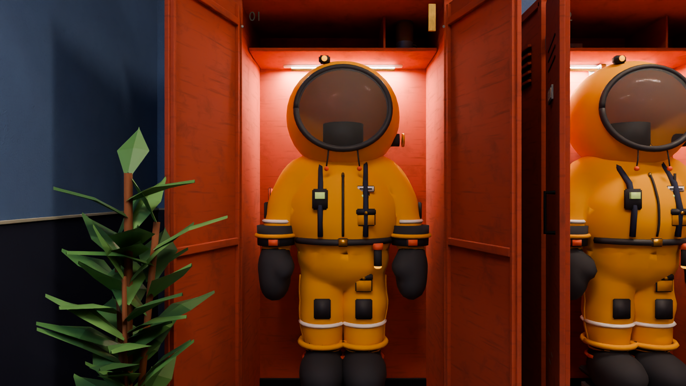 | 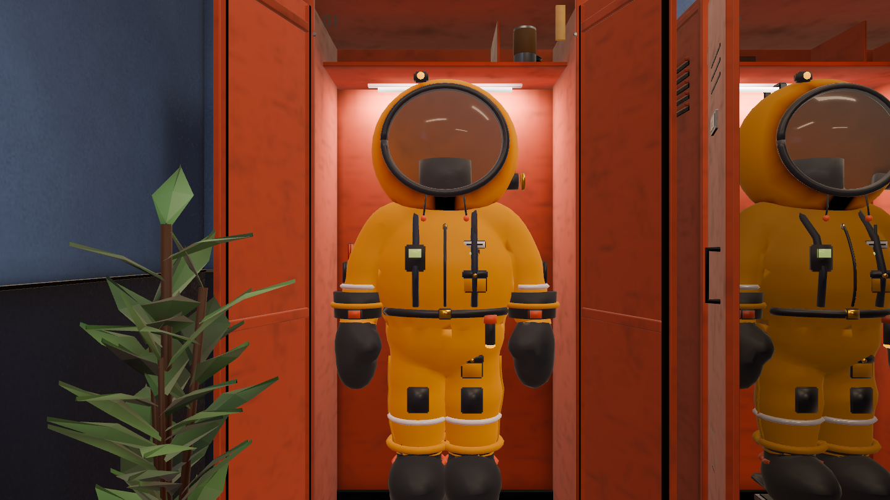 |
| Hood interior | 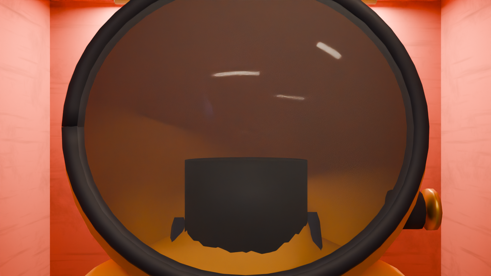 | 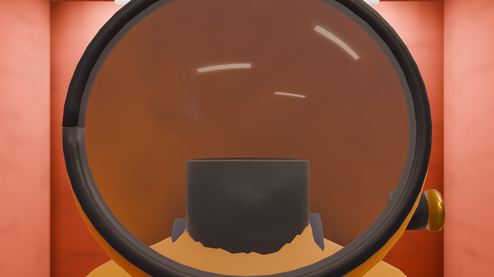 |
| Worn face / visor | 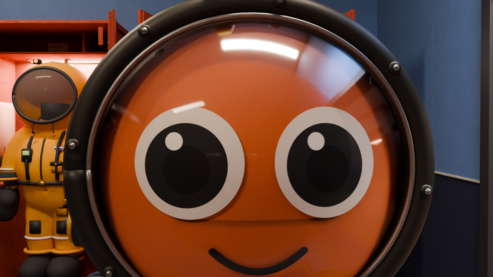 | 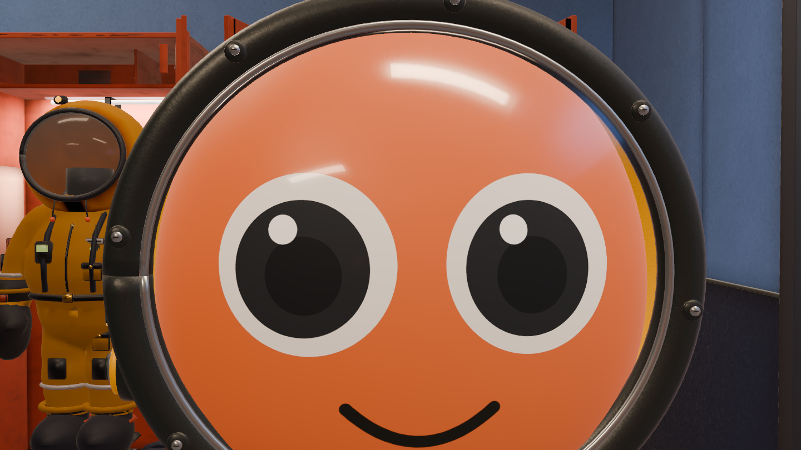 |
| Worn suit | 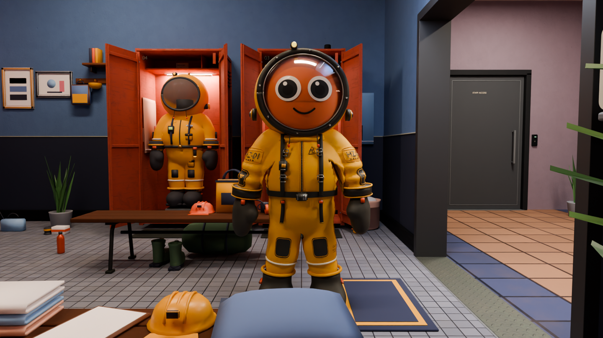 | 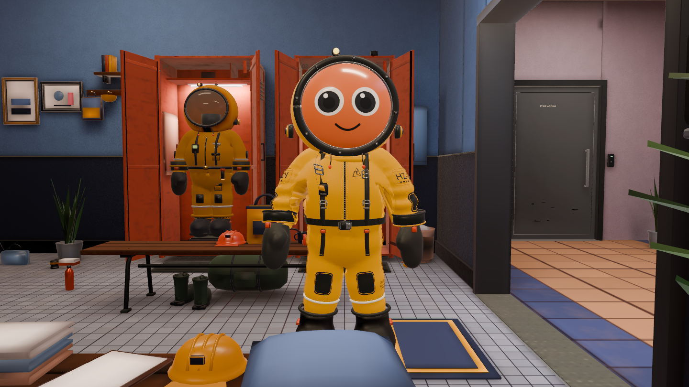 |
| Worn three-quarter | 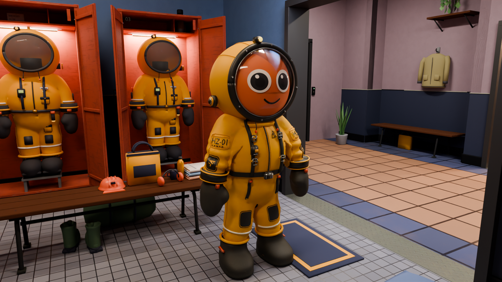 | 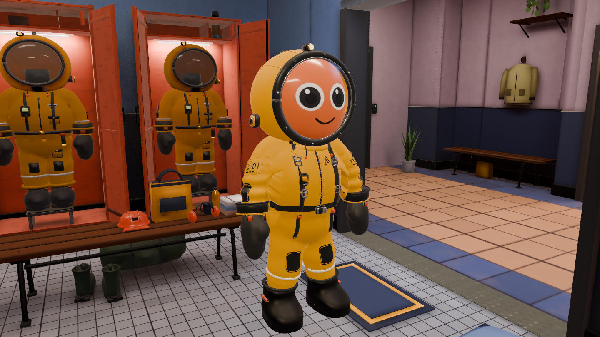 |

## Room regression check

These are fresh captures from the same saved scene as the suit comparison above.
All approved room atlas hashes/material definitions are unchanged; the corrected
reflection imports remove both the wall speckles and hard bands on locker/pod
surfaces. This check preserves the earlier room appearance rather than grading
source colours from screenshots.

| Room | Blender reference | Current Unity |
|---|---|---|
| Hall | 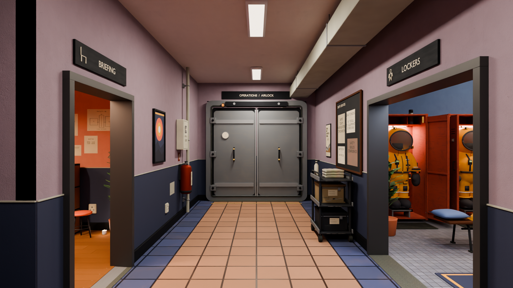 | 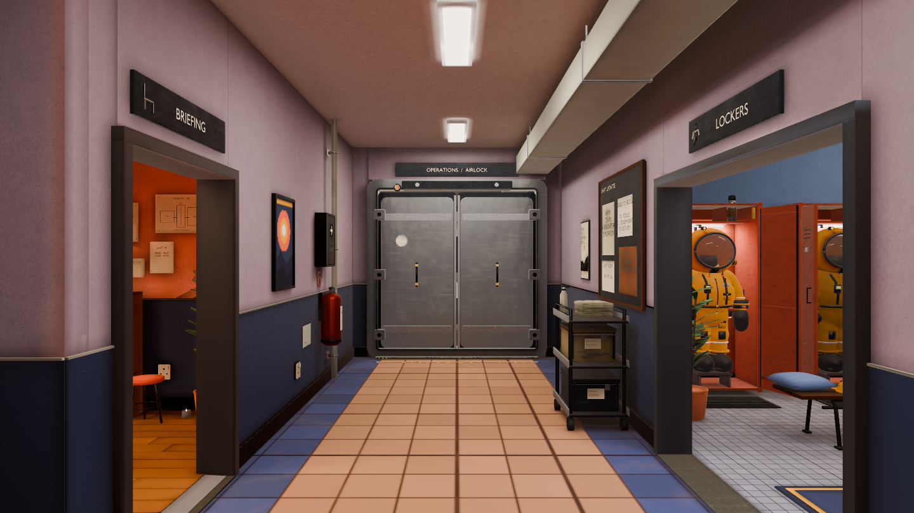 |
| Briefing | 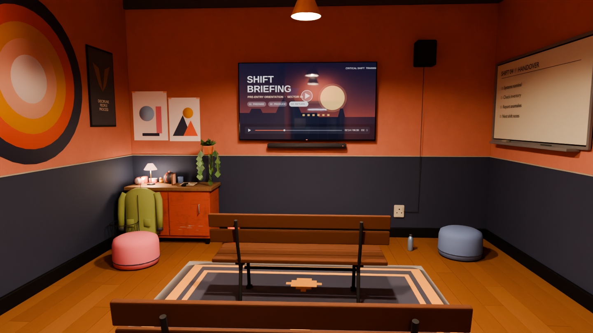 | 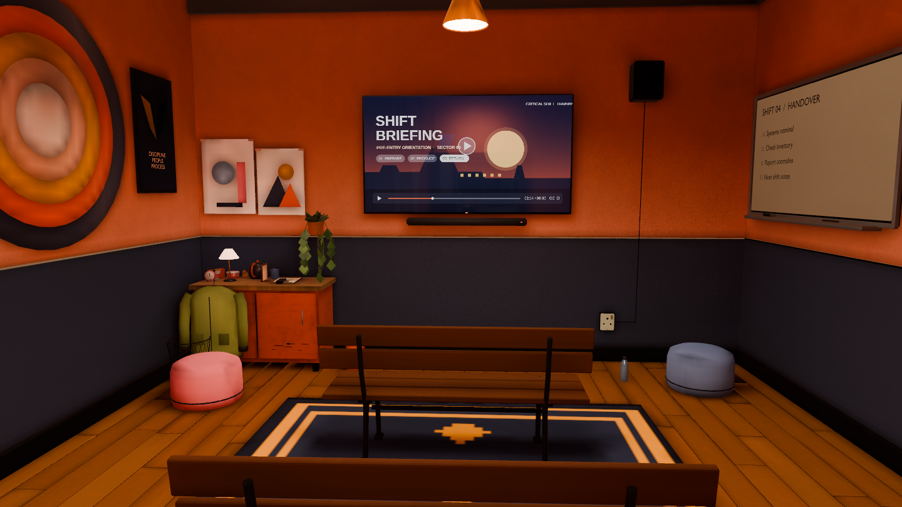 |
| Lockers | 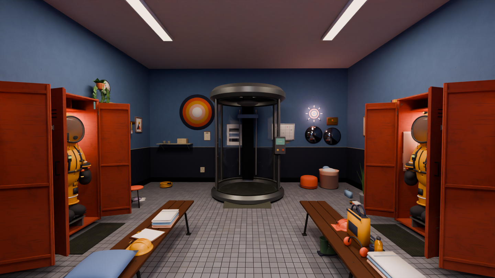 | 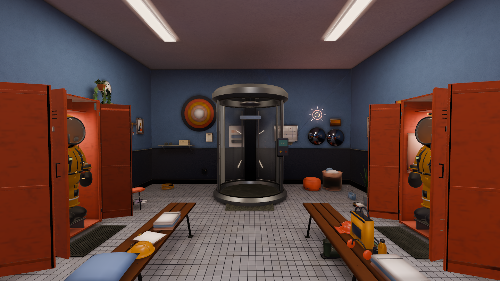 |

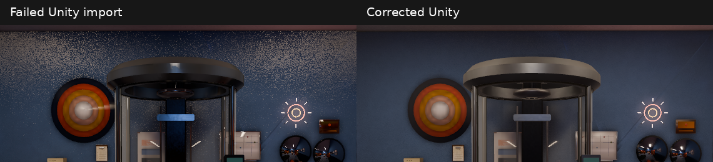

## Validation

The pinned Unity 6000.4.3f1 native bake passed: two lightmaps, 390 light probes,
two shadow masks and three persisted specular-filtered reflection cubemaps. Eight
final comparison captures were inspected from the saved gameplay scene (three
rooms, two hanging views, three worn views). The native [PlayMode report](playmode.xml)
executed **17 tests: 17 passed, zero failed/skipped**, including physical seating,
locker timing/atomic outfit visibility, airlock traversal, integrity pod, source
suit/face materials and reflection filtering. The strict Linux development Player
build with LZ4HC packaging passed, then its real graphics smoke ran 120 frames and
exited cleanly with `CS_PLAYER_ROOM_SMOKE_OK`.

Offline API compilation passed for four player assemblies; 40 Python tooling tests
passed. The final static check found 1040 unique metadata GUIDs, nine asmdefs and
22 C# files. The Blender FBX round trip and geometry/weights/curve comparison passed.
[Source preservation](source-preservation.json) confirms all 51 staged inputs, six
room mesh/collider pairs and all approved room atlas hashes/material definitions.
The shared room surface shader is byte-identical to `467a4112`. The prepared-scene
guard includes the rig manifest, both FBXs, suit atlas/face image hashes and hood
occlusion derivative; capture/build enforce filtered linear reflections with
trilinear/clamped sampling. The [wall patch measurement](wall-measurements.json)
returns highpass RMS 0.768 versus the approved 0.775 at identical coordinates;
this is a local regression check, not a global acceptance score.

[Machine-readable evidence](evidence.json) records the final artifact hashes and
bounded checks. Full canonical-domain/CI evidence from the earlier PR remains
historical until the new head's CI finishes; it is not relabelled as this run.

Initial attempts are retained in `runtime/out/spawn-suit-audit/`: two Blender
module-path/graph-alias errors, an import that exhausted disposable cache space
and memory, and an animation FBX initially routed through the static importer.
The first face binding also exposed empty optional JSON texture records, which
were corrected. One bake was deliberately superseded while disabling automatic
character material conversion. Player packaging briefly exhausted disk space;
a verified older-build archive was moved to memory storage and packaging continued.
Those attempts are retained as failures/superseded runs, not final evidence. Regenerating the source clips
also exposed arm-curve differences; the implementation now preserves the prior
animation payload. No independent review or art acceptance is claimed.

For this container, the optional `-csCompressedBuild` flag packages the development
Player with Unity's LZ4HC compression. Asset content is unchanged; this is not a
performance measurement. Full-resolution final graphics use Mesa llvmpipe, not a
target gaming GPU. PR 101 remains draft and unmerged.
