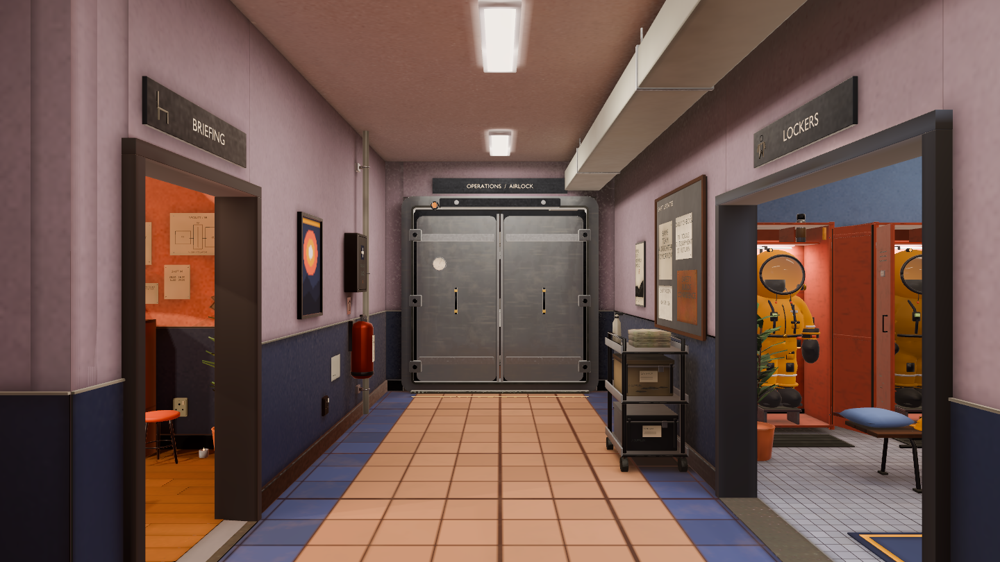
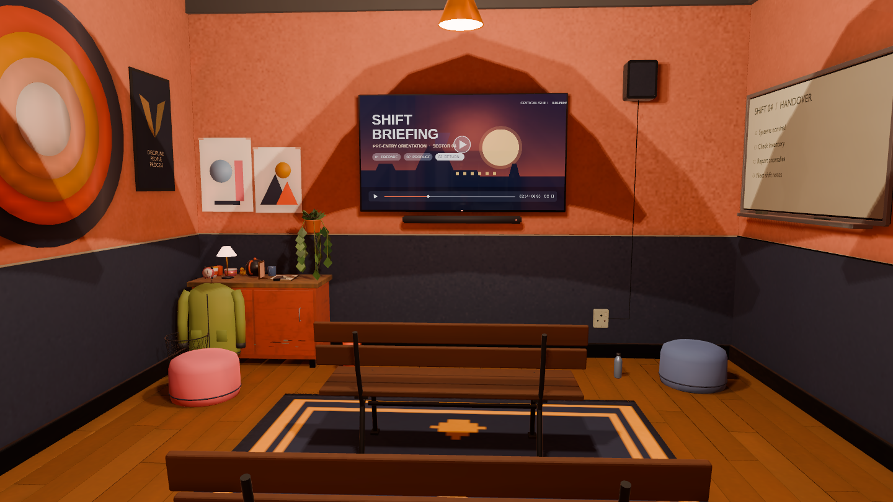
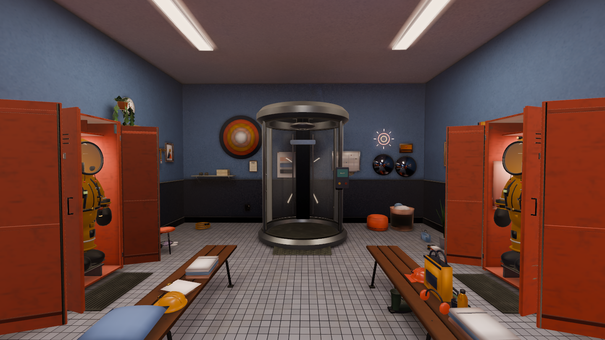

# Spawn visual comparison

These are real Blender and Unity renders at the same three authored cameras, at
1440×810. They are evidence for review, not an art acceptance declaration.

Spawn is placed on the six-room PR95 assembly (`bb6b4924`); the source room,
assembly builder, placement records and existing character animation sources are
unchanged. Later main changes did not modify those inputs. The other five rooms
retain their preview material conversion.

| Room | Blender source | Unity saved gameplay scene |
|---|---|---|
| Spawn hall |  |  |
| Briefing |  |  |
| Lockers |  |  |

The conversion preserves evaluated source geometry, original screen artwork,
procedural shader input maps and Blender's AgX display transform. Fine floor and
text meshes have dedicated texture atlases. Unity bakes the 22 authored practical
lights, uses light probes for moving objects, and saves three reflection cubemaps.
Point lights bake indirect illumination with a reference-calibrated intensity and
use real-time direct light with fixture shadows in the forward renderer. Embedded
bulb surfaces preserve their visible geometry while avoiding shadow self-occlusion.
The player camera uses the same display transform as these captures.

Cycles and Unity's built-in renderer differ in light transport, specular response,
refraction and shadow filtering. These images must not be described as
pixel-identical. Briefing still has visibly different pendant shadows and ceiling
brightness; surface grain, metal reflections and screen reflections also differ.
These differences remain open art work. Glass uses the source constant coverage (pod 16%, visor 10%) as a
raster approximation. Human art/feel review, remote-peer behavior and target-GPU
performance have not been accepted by this automated validation.

See [SPAWN_ROOM.md](../SPAWN_ROOM.md) for reproduction and validation, and
[spawn-visual-evidence.json](../spawn-visual-evidence.json) for hashes and results.
