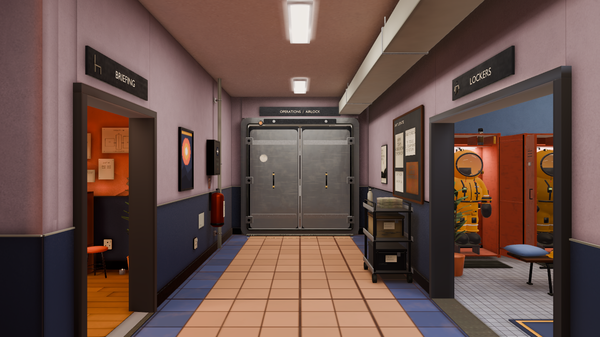
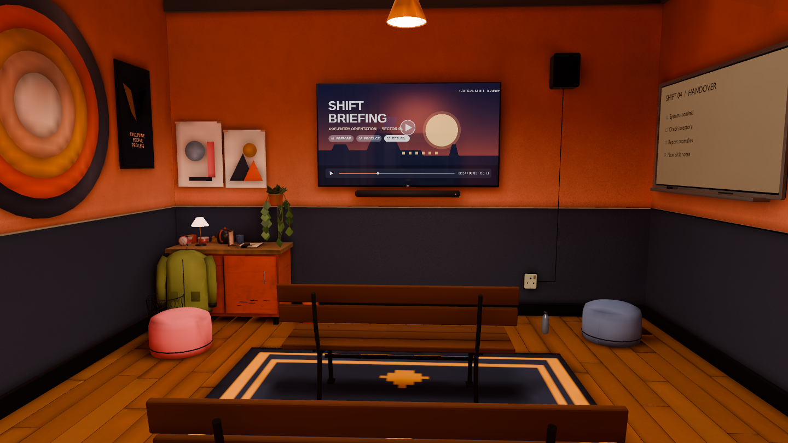
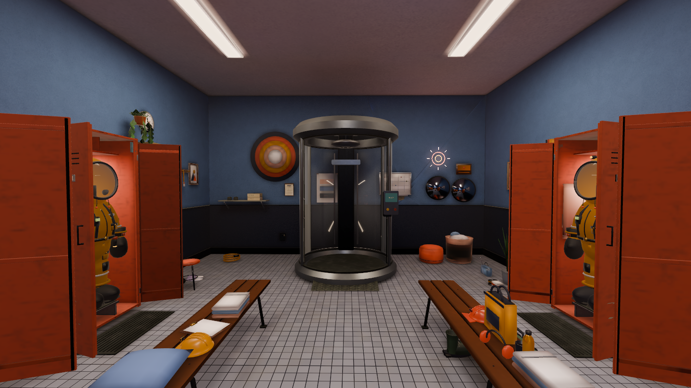
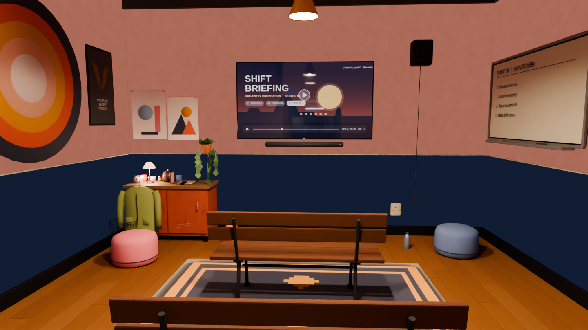

# Spawn wall correction comparison

Real captures at the three original 1440×810 camera poses. Blender references
come from the pinned PR95 spawn source. Corrected Unity captures render the saved
gameplay scene after the final light bake; the same materials/display transform
are used by the player camera. No Blender source or assembly builder was edited.

| Room | Original Blender reference | Corrected Unity gameplay scene |
|---|---|---|
| Spawn hall |  |  |
| Briefing |  |  |
| Lockers |  |  |

The [previous Unity captures](../spawn-visual-20261011/README.md) retain the before
state: coarse wall grain and hard pendant silhouettes. This correction preserves
source dielectric reflectivity, gives 52 wall/dado meshes dedicated texture
density, and retains finite-source baked shadow masks. Six socket faces use probe
lighting to avoid a dark-chart regression found in the first correction bake.

The current walls have much closer terracotta/charcoal hues and pendant falloff.
The sideboard's local illumination, screen reflections, glass and some material
response still differ. These renders are review evidence, not perfect Cycles
matching or accepted art. Other five rooms remain preview conversions.

## Diagnostic image — not a final Unity view

This image was rendered in Blender with wall lighting removed to isolate source
colour. Its pale pink upper wall and navy lower wall do not describe the final
Unity capture above. The source reference is the normally lit original PNG in
the comparison table. Screenshot colour estimates from Claude's review were
checked against those original PNGs, not used to repaint the source materials.

[Correction note](../SPAWN_VISUAL_CORRECTION.md) ·
[Validation evidence](../spawn-wall-correction-evidence.json) ·
[Reproduction](../SPAWN_ROOM.md)
